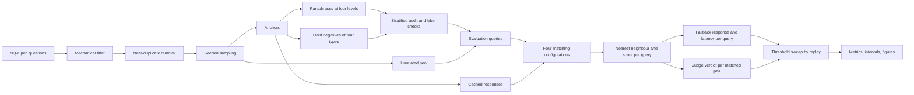
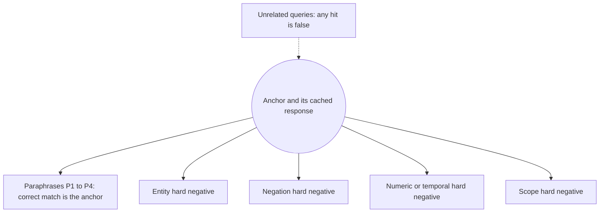
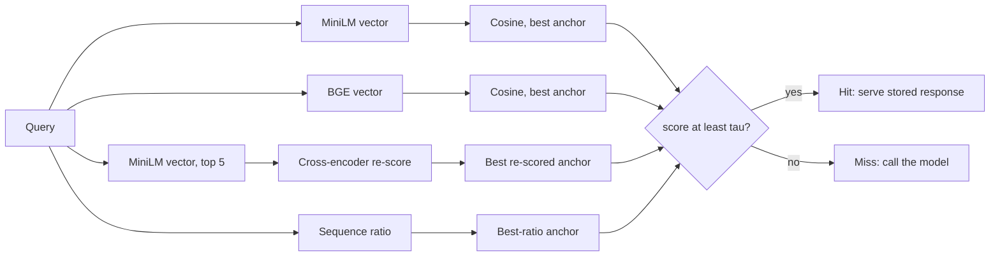
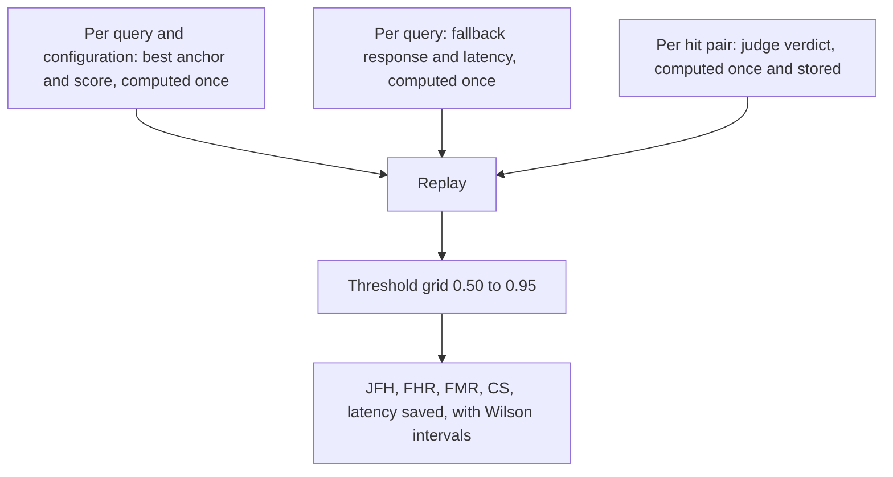

# Semantic Caching for RAG/LLM Pipelines — Correctness vs. Cost Tradeoffs Under Controlled Paraphrase Variation

*Poornima Institute of Engineering and Technology — Technical Seminar (guide-supervised)*

---

## Abstract

Semantic caching reduces inference cost and latency in large language model (LLM) and retrieval-augmented generation (RAG) pipelines by serving cached responses to semantically similar queries. Existing systems optimize hit rate and latency through fixed similarity thresholds or reduce false-hit rates through improved context-awareness, while recent work reframes evaluation as a threshold-calibration problem to measure precision-versus-utilization tradeoffs across models. However, these approaches fail to isolate the false-hit rate as a function of semantic distance between a query and its paraphrase, independent of the underlying embedding model. This paper introduces a framework to analyze these trade-offs using a controlled synthetic paraphrase workload constructed across defined similarity bands: near-duplicate, loose paraphrase, and topic-adjacent queries. By sweeping cache similarity thresholds across representative embedding architectures, we measure false-hit rates that induce correctness violations alongside corresponding token cost savings. We map the resulting cost-correctness frontier as a function of paraphrase distance, providing model-agnostic threshold selection guidance to stabilize semantic cache deployments. This complements calibration-based model-selection approaches by isolating the query-similarity axis those models hold fixed.

**Keywords:** semantic caching, large language models, retrieval-augmented generation, similarity threshold, false-hit rate, hard negatives, LLM-as-judge

---

## I. Introduction

Every call to a large language model costs compute and time, and for hosted models it costs money as well. Much of the traffic that reaches such systems is repetitive: people rephrase a question they or someone else has already asked, or send the same request in slightly different words. Exact-match caching misses nearly all of this, because a single changed word produces a different key. Semantic caching goes after the repetition directly. It encodes each incoming query as a vector, finds the closest previously answered query, and returns the stored response when the two are similar enough, so the model is never invoked. In a retrieval-augmented generation (RAG) pipeline [1] a hit also skips retrieval, because the cache sits in front of the whole pipeline. Open-source and research systems report the benefit in concrete terms: GPTCache reports responses that are 2 to 10 times faster when the cache is hit [2], and ContextCache reports cached responses with about ten times lower latency than a direct model call [3].

The difficulty is that a close vector is not the same thing as the same question. A query that swaps one city for another, flips a negation or changes a year can sit very near the original in embedding space while needing a different answer. When the cache returns the old answer anyway, we call it a false hit. A false hit is a worse outcome than a miss. A miss costs one extra model call, whereas a false hit delivers a wrong answer that looks like any other cached answer. Most caches control this risk with a single static similarity threshold. The vCache authors observe that static thresholds give no formal correctness guarantee and can produce unexpected error rates [4]. This is the problem we study, and we study it from a particular angle: not whether a better threshold policy exists, but what a given threshold actually tolerates and what it lets through.

The existing evidence on this question comes mostly from logged or benchmark traffic. MeanCache is evaluated against GPTCache on precision and F-score [5]. SCALM starts from an analysis of real chat data and reports gains in hit ratio and token savings [6]. Krites evaluates on trace-driven simulations built from two vCache benchmarks, one of Chatbot Arena prompts and one of search queries, and its main results approve a cached answer whenever both prompts share an equivalence class defined by the benchmark [7]. These are reasonable designs for their purposes. They share a limitation for our question, though. In logged traffic, nobody controls how many of the near-duplicates are true paraphrases and how many are look-alikes that need a different answer, and nobody can say which kind of look-alike caused a given error. An aggregate error rate hides that.

We take the opposite approach and build the traffic. Each evaluation query is generated from a real question as a paraphrase, as a hard negative along one of four named perturbation types, or as an unrelated query, so its intended relationship to the cached question is controlled by construction. A stratified audit provides a limited diagnostic of the generated labels. We then sweep the threshold over several matching methods and measure whether a separate LLM judge accepts each reused response and whether the match agrees with the constructed label. The paper makes four contributions.

1. A controlled benchmark for semantic caching in which every query is a labeled paraphrase, a hard negative of a known type, or an unrelated query, built from real questions and checked with a stratified diagnostic audit.
2. A correctness measure based on whether a separate LLM judge accepts the reused response, with label-based error rates as a secondary cross-check.
3. A like-for-like comparison of four matching configurations under one cost accounting: two bi-encoder models, bi-encoder retrieval with cross-encoder reranking, and lexical matching.
4. A replay design in which the nearest neighbour, the fallback model response and the judge verdict are computed once per query and reused across every threshold, so a full threshold sweep is cheap and exactly repeatable.

The rest of the paper is organized as follows. Section II reviews related work. Section III states the research gaps and our research questions. Section IV describes the methodology in full. Section V presents the analysis and discussion. Section VI covers threats to validity and Section VII concludes.

---

## II. Background and Related Work

### A. How a semantic cache works

A semantic cache holds pairs of a past query and the response that was generated for it. For an incoming query, an encoder maps the text to a vector. Sentence encoders such as Sentence-BERT [8] and SimCSE [9] are trained so that vectors of related sentences lie close together, and in the dense-retrieval setting the same idea is used to match questions against passages [10]. The cache looks up the cached query whose vector is closest, usually by cosine similarity, using exact search or an approximate index such as a graph-based one [11], [12]. If the similarity reaches a threshold τ, the cache returns the stored response and counts a hit. Otherwise it counts a miss and the model is called. We use *false hit* for a hit whose response is not acceptable for the incoming query, and *false miss* for a miss on a query whose paraphrase was in the cache. Both errors depend on the encoder, on the kind of query variation, and on where τ sits. Measuring that dependence directly is the aim of this paper.

### B. Semantic caching systems

GPTCache is an open-source semantic cache for LLM applications. It stores model responses and returns them on a hit, and the paper reports 2 to 10 times faster responses on a hit together with response times that are not affected by network fluctuation [2]. Its reported results concern speed and cost, and the abstract does not describe a study of how correctness changes with the similarity threshold. GPT Semantic Cache builds a caching layer on embeddings and reports that it reduces API calls by up to 68.8% across query categories, with hit rates between 61.6% and 68.8% and positive hit rates above 97% [13]. SCALM starts from an analysis of real human-to-LLM chat data and argues that existing methods do not exploit semantic connections between queries. Its architecture identifies important cache entries and patterns, and it reports, relative to GPTCache, an average 63% higher cache hit ratio and 77% higher token savings [6].

Two works improve the similarity model itself. MeanCache runs on the user's side, trains its similarity model by federated learning so that user data stay private, and encodes context chains to tell contextual queries from standalone ones. Against GPTCache it reports about 17% higher F-score and 20% higher precision, an 83% smaller storage requirement, and 11% faster hit-or-miss decisions [5]. A report from Redis fine-tunes a compact encoder on Quora question pairs and on medical question pairs. On the medical data, precision rises from 78% to 92%, and a model trained on about 35,000 synthetic pairs alone reaches 87%, compared with 85% for OpenAI's text-embedding-3-large [14]. Both results show that the quality of the similarity function matters. Neither isolates what a fixed, off-the-shelf encoder does at a given threshold across different kinds of near-miss, which is what we measure.

A third group targets multi-turn conversation, where the same sentence can mean different things depending on what came before. ContextCache is a demonstration paper that adds context awareness to semantic caching for multi-turn queries [3]. SmartCache uses a semantic forest to index conversational turns, detects context changes from attention scores, and shares key-value cache state across sessions. On CoQA and SQuAD it reports up to 59.1% lower key-value memory use than prefix caching, 78.0% and 71.7% lower time-to-first-token, and higher answer quality (39.9% higher F1 for one model on CoQA) [15]. Our setting is single-turn by design, so that the effect of paraphrase and perturbation is not mixed with the effect of dialogue history.

The closest work to ours treats correctness as the quantity to control. vCache describes itself as the first verified semantic cache with user-defined error-rate guarantees. It replaces the single static threshold with a policy that meets a bound the user sets, and it reports that it consistently meets the specified bounds while outperforming static-threshold and fine-tuned embedding baselines [4]. Krites keeps the serving path of an ordinary static-threshold cache and adds an asynchronous LLM judge. When a prompt's nearest curated answer falls just below the threshold, the judge decides off the critical path whether the answer fits, and an approved answer is promoted into the dynamic cache. On trace-driven simulations it raises the fraction of requests served from curated answers from 8.2% to 19.4% on conversational prompts and from 2.2% to 8.6% on search queries, with critical-path latency unchanged. Its main results use an oracle judge based on the benchmark's equivalence classes, and a separate check found that a real LLM judge agreed with human labels on 99 of 100 borderline pairs [7]. Both papers show that the threshold–correctness relationship matters in practice. What they do not report, in the material we reviewed, is a sweep over a corpus where the difficulty of the near-misses is itself set and labeled by type.

### C. Neighbouring work on LLM cost

Some cost-saving work sits next to response caching but is a different thing. FrugalGPT proposes strategies to cut LLM cost, including prompt adaptation, LLM approximation and an LLM cascade that learns which model to use for each query. It reports matching the best single model (GPT-4) with up to 98% lower cost, or improving accuracy over GPT-4 by 4% at the same cost [16]. RAGCache stores the intermediate key-value states of retrieved documents in a GPU and host-memory hierarchy and reports up to 4 times lower time-to-first-token and up to 2.1 times higher throughput than vLLM with Faiss [17]. Prompt Cache reuses attention states for recurring prompt segments and reports time-to-first-token speedups of about 8 times on GPU and 60 times on CPU [18]. All three save work inside or around generation. A response-level semantic cache, our subject, decides whether generation can be skipped altogether, and so it alone carries the risk of returning an answer to the wrong question.

### D. Perturbation-based evaluation in NLP

The idea of testing a model with small, targeted edits is established in NLP, and we borrow its logic. PAWS builds 108,463 paraphrase and non-paraphrase pairs with high lexical overlap, and it shows that models trained on earlier paraphrase datasets perform very poorly on it [19]. Contrast sets ask dataset authors to perturb test instances in small ways that usually change the gold label, and for ten datasets they report performance up to 25% lower than on the original test sets [20]. CheckList organizes behavioural tests as a matrix of linguistic capabilities and test types, and it found critical failures in commercial and state-of-the-art models [21]. For negation in particular, an analysis of large language models finds insensitivity to the presence of negation, an inability to capture its lexical semantics, and a failure to reason under negation [22]. That last finding is a reason to expect negation to be a hard case for similarity-based matching, though we treat it as something to measure and not to assume. None of these resources is organized as a cache. They have no cached responses, no threshold, and no hit or miss, which is why we build a corpus of our own. Table II places them next to our design.

### E. LLM judges

Using a language model to grade outputs is now common, and its limits are known. In the MT-Bench study, strong judges such as GPT-4 reached over 80% agreement with human preferences, the same level as agreement between humans, while the authors also examined position, verbosity and self-enhancement biases [23]. G-Eval reports a Spearman correlation of 0.514 with human judgments on summarization with GPT-4, and it flags a possible bias of LLM-based evaluators toward LLM-generated text [24]. Later work finds that self-preference is linked to the model's ability to recognize its own output [25]. These findings motivate our use of a judge from a different model family than the corpus generator and cached-response model. The small stratified audit is reported only as a diagnostic.

**TABLE I. Semantic-cache and related LLM-cost work compared with this paper.**

| Work                         | Contribution                                                         | Reported evidence                                                               | Relation to this paper                                                       |
| ---------------------------- | -------------------------------------------------------------------- | ------------------------------------------------------------------------------- | ---------------------------------------------------------------------------- |
| GPTCache [2]                 | Open-source cache that stores LLM responses and serves them on a hit | 2–10× faster responses on a hit                                               | We study correctness as a function of threshold, which the abstract does not |
| GPT Semantic Cache [13]      | Embedding-based caching layer                                        | Up to 68.8% fewer API calls; hit rates 61.6–68.8%; positive hit rate above 97% | Same goal; we add typed near-misses and a judge on the reused response       |
| SCALM [6]                    | Cache built on analysis of real chat data                            | Relative to GPTCache, on average: +63% hit ratio, +77% token savings            | Built from an analysis of real chat data; we control the query mix           |
| MeanCache [5]                | User-side cache, federated similarity model, context chains          | ~17% higher F-score, ~20% higher precision, 83% less storage vs. GPTCache       | They improve the similarity model; we measure fixed encoders                 |
| Redis domain embeddings [14] | Fine-tuned compact encoder with synthetic data                       | Medical precision 78% → 92%; synthetic-only 87%                                | Complementary; we do not fine-tune                                           |
| ContextCache [3]             | Context-aware caching for multi-turn queries                         | About 10× lower latency for cached responses                                   | Multi-turn; ours is single-turn                                              |
| SmartCache [15]              | Semantic forest, context-change detection, cross-session KV sharing  | Up to 59.1% less KV memory; TTFT −78.0% and −71.7%                            | Multi-turn and KV-level; ours is response-level                              |
| vCache [4]                   | Verified cache with user-defined error-rate bound                    | Meets specified bounds; beats static and fine-tuned baselines                   | Closest in aim; we characterize what a static threshold tolerates by type    |
| Krites [7]                   | Asynchronous LLM-judge promotion of curated answers                  | Static-origin served fraction 8.2→19.4% and 2.2→8.6%                          | Judge inside the policy; ours is offline evaluation on a controlled corpus   |
| FrugalGPT [16]               | LLM cascade and related cost strategies                              | Up to 98% cost reduction at GPT-4 quality                                       | Model selection, not response reuse                                          |
| RAGCache [17]                | KV-state cache for retrieved documents                               | TTFT up to 4×, throughput up to 2.1×                                          | Below the response layer                                                     |
| Prompt Cache [18]            | Attention-state reuse for prompt segments                            | TTFT ~8× (GPU), ~60× (CPU)                                                    | Below the response layer                                                     |

**TABLE II. Perturbation-based benchmarks compared with this paper's corpus.**

| Resource           | How the variants are made                                                                                 | Organized by named perturbation type              | Cache entries and a threshold |
| ------------------ | --------------------------------------------------------------------------------------------------------- | ------------------------------------------------- | ----------------------------- |
| PAWS [19]          | Word swapping and back translation; high lexical overlap                                                  | No                                                | No                            |
| Contrast sets [20] | Dataset authors perturb test instances so the label usually changes                                       | By dataset                                        | No                            |
| CheckList [21]     | Matrix of linguistic capabilities and test types                                                          | Yes, by capability and test type                  | No                            |
| This paper         | LLM-generated paraphrases at four levels; hard negatives of four types; reviewed on a 90-item stratified audit | Yes: entity, negation, numeric or temporal, scope | Yes                           |

---

## III. Research Gaps

Reading across these works, we see four gaps. Each one leads to a research question that the rest of the paper answers.

**Gap 1: no typed account of what a threshold lets through.** The caching papers above report aggregate quantities such as hit rate, precision, F-score or an error bound. In the material we reviewed, none reports how the false-hit rate changes with the threshold separately for entity substitution, negation, numeric or temporal change and scope change. *RQ1: How does the false-hit rate move with the threshold for each type of near-miss, and which types does a given threshold fail on first?*

**Gap 2: correctness is mostly defined at the level of query labels.** Krites's main results approve a cached answer when two prompts share a benchmark class [7], and a pair can share a class while the particular stored response still fails the new query. *RQ2: How often does a judge's verdict on the reused response disagree with the label of the matched pair, and for which query types?*

**Gap 3: perturbation testing exists, but not for caches.** PAWS, contrast sets and CheckList show how much a targeted edit can reveal, yet none has cache entries, stored responses or a threshold. *RQ3: Can a typed corpus built from real questions expose differences between matching methods that aggregate evaluation hides?*

**Gap 4: matching methods are rarely compared under one corpus and one cost accounting.** The caching papers evaluate their own matcher against a baseline. *RQ4: Under identical queries, an identical cache and an identical judge, how do bi-encoder matching with two embedding models, cross-encoder reranking and lexical matching trade false hits against cost savings?*

---

## IV. Methodology

### A. Overview

The methodology has two halves. The first half builds a corpus in which the relationship between every evaluation query and the cache is known. The second half runs matching methods over that corpus, scores every hit, and sweeps the threshold. Fig. 1 shows the whole flow. The design rule that holds it together is that anything expensive, such as a model call, is performed once per query and stored. Thresholds are applied afterwards by replaying stored results.

**Fig. 1. End-to-end pipeline.**

### B. Problem formulation and metrics

**Setting.** The cache is a fixed set of anchor questions C, each stored with a response r(a) generated by the fallback model. The cache is static: a miss does not insert the new query. We chose this so that the outcome for one query never depends on the order of other queries, which is what makes replay across thresholds exact. Eviction is therefore out of scope, and Section VI discusses what that leaves out.

For an incoming query q, a matching configuration returns a candidate a\*(q) in C and a score s(q). The cache declares a hit at threshold τ when s(q) ≥ τ and a miss otherwise (1). On a hit the response r(a\*(q)) is served. On a miss the fallback model is called.

  hit_τ(q) = 1 if s(q) ≥ τ, else 0                                   (1)

For the bi-encoder configurations, s(q) is the largest cosine similarity between the vector of q and the vector of any anchor, and a\*(q) is the anchor that achieves it. The other configurations define s(q) in Section IV-E.

**Primary measure: judged false-hit rate.** For every hit, an LLM judge J receives the incoming query, the matched anchor and the stored response, and returns a binary verdict: acceptable or unacceptable for the incoming query. We evaluate the reused response and not the pair label, because a matched pair can carry the right label while the particular stored response still does not answer the new query. The judged false-hit rate is the share of hits whose response is judged unacceptable (2).

  JFH(τ) = |{q : hit_τ(q) and J(q) = unacceptable}| / |{q : hit_τ(q)}|          (2)

**Secondary measure: query-level false-hit rate.** As a cross-check that does not depend on any judge, every hit is also scored against the construction label. A hit is a true hit (TH) if q is a paraphrase query and a\*(q) is its own anchor, and a false hit (FH) in every other case. This includes a paraphrase that lands on the wrong anchor, a hard negative and an unrelated query (3).

  FHR(τ) = FH(τ) / (TH(τ) + FH(τ))                                          (3)

If JFH and FHR diverge, that divergence is a result. It means the judge accepts responses to label-mismatched pairs, or rejects responses to correctly matched ones. We report it by query type.

**False misses.** Let Q_para be the paraphrase queries. Each has its anchor in the cache, so a miss on a paraphrase query is a false miss (4).

  FMR(τ) = |{q in Q_para : hit_τ(q) = 0}| / |Q_para|                          (4)

**Cost.** Each miss triggers exactly one fallback call, so the saving over a system with no cache is the share of queries that never reach the model (5). Alongside it we report the local latency saved (6), where ℓ_LLM(q) is the stored latency of the fallback call for q and ℓ_lookup(q) is the measured lookup time of the configuration.

  CS(τ) = 1 − |{q : hit_τ(q) = 0}| / |Q|                                    (5)

  ΔL(τ) = Σ over hits q of ( ℓ_LLM(q) − ℓ_lookup(q) )                       (6)

Cost is therefore expressed as model calls avoided and local compute and latency saved, not as API prices.

**Uncertainty.** Every rate is a proportion k out of n and is reported with a Wilson 95% interval (7), where p̂ = k/n and z = 1.96. We use the Wilson interval because it behaves well for small samples and for proportions near 0 or 1, where the simple normal approximation does not [26], [27].

  [ p̂ + z²/(2n) ± z · sqrt( p̂(1−p̂)/n + z²/(4n²) ) ] / ( 1 + z²/n )              (7)

**The tradeoff curve.** The central result is JFH(τ) plotted against CS(τ) as τ varies, with FHR(τ) as a second trace. A point on this curve means little without its cost saving, because a threshold so strict that it never hits has a false-hit rate of zero on any measure.

### C. Corpus construction

**Anchor source.** Anchors come from NQ-Open, the open-domain version of Natural Questions introduced for open-domain question answering [28]. Natural Questions consists of real, anonymized queries issued to Google Search [29]. We chose real questions so that the surface forms of the anchors are not themselves a product of our generator. We load the dataset at a pinned revision so that the same questions are drawn on every run.

**Filtering and deduplication.** A mechanical filter removes records with an empty question, control characters, no alphabetic character, a URL or markup, a token count outside a fixed range, or one token that dominates the question, and records with no usable answer. Tokens are lowercase runs of Unicode letters and digits, so punctuation and underscores separate tokens. Near-duplicate questions are then removed using the Jaccard similarity of token sets, with the first occurrence kept. The comparison uses a prefix filter, which indexes only the rarest tokens of each set so that most pairs are never compared and every pair that could reach the threshold is still checked exactly [30]. Deduplication matters here for a concrete reason: duplicated text is common in datasets and inflates results when the same content appears on both sides of a comparison [31]. In our case a near-duplicate of an anchor sitting among the unrelated queries would be a labeling error.

**Sampling.** With a fixed seed we draw 100 anchors, 50 separate development anchors, and a held-out pool of 1,000 questions. The development anchors are used only to debug prompts and the pipeline, and they never enter the cache or the reported results. The 100 unrelated queries come from the held-out pool and must have a token-level Jaccard similarity of at most 0.2 with every anchor.

**Paraphrases.** For each anchor the generator writes four paraphrases, one for each of four intended difficulty levels that run from light word substitution (P1) to heavy rewording (P4). For every paraphrase we record two covariates: its token-level Jaccard overlap with the anchor and its normalized edit distance from the anchor. These measured values let us check that the intended levels are ordered the way we intended, and they let us analyze false misses against measured distance and not only against the label.

**Hard negatives.** The hard negatives are the part of the corpus that does the real testing. A cache that only rejects dissimilar text is not being tested at all. The queries that expose a cache are those that look alike and need a different answer. We generate them along four types, each defined relative to the anchor and abbreviated by its initial.

**TABLE III. Hard-negative types, with illustrative pairs written for this paper (not drawn from the corpus).**

| Type                          | Definition                                      | Anchor                             | Hard negative                       |
| ----------------------------- | ----------------------------------------------- | ---------------------------------- | ----------------------------------- |
| E, entity substitution        | Same question shape, a different named entity   | who directed the film Inception    | who directed the film Interstellar  |
| N, negation or polarity flip  | Same shape, opposite truth condition            | which planets have rings           | which planets do not have rings     |
| T, numeric or temporal change | Same shape, a different quantity, date or range | who won the FIFA World Cup in 2018 | who won the FIFA World Cup in 2014  |
| S, scope change               | Same shape, a narrower or broader subject       | what is the population of Jaipur   | what is the population of Rajasthan |

The generator produces up to 50 hard negatives for each type. When a perturbation does not apply to an anchor, the generator may answer that it does not apply, and we skip the anchor. We never force a perturbation, because a forced hard negative is likely to be a bad one. A generated query is rejected if it is not valid output, if it equals the anchor after normalization or equals any paraphrase of the same anchor, or if its length differs from the anchor's by more than a factor of two. Each rejected query is regenerated up to three times. Each type is tagged on the individual query, so that every result can be broken down by type.

**Unrelated queries and cached responses.** The unrelated queries serve as a floor check and not as a discriminating test: any hit on one is a false hit. For each anchor, the fallback model writes a response once, at temperature 0, and that response is stored in the cache.

**Evaluation queries.** The evaluation set therefore contains 400 paraphrases, at most 200 hard negatives and 100 unrelated queries, so at most 700 queries.

**Fig. 2. Structure around one anchor.**

### D. Label verification

A generated label is only as trustworthy as its check. We draw a stratified sample of 90 queries across nine strata: four paraphrase levels, four hard-negative types and the unrelated set, with ten items in each. Reviewers assess whether each query has the same information need as its anchor, whether its correct answer differs, and whether the cached response is acceptable, without seeing the intended subtype label. We compare the audit assessments with constructed labels by stratum. The predefined 90% per-stratum criterion is reported as a diagnostic; categories below it are reported as such. With ten items per stratum, the audit is coarse and does not estimate small error rates.

### E. Matching configurations

We compare four configurations. They differ in how they compute the candidate a\*(q) and the score s(q), and they share everything else.

**TABLE IV. Matching configurations.**

| Configuration                           | Candidate and score                                                                                                               |
| --------------------------------------- | --------------------------------------------------------------------------------------------------------------------------------- |
| Bi-encoder with all-MiniLM-L6-v2        | Largest cosine similarity over all anchors; vectors are 384-dimensional                                                           |
| Bi-encoder with bge-base-en-v1.5        | Largest cosine similarity over all anchors; vectors are 768-dimensional                                                           |
| Bi-encoder with cross-encoder reranking | The five closest anchors under all-MiniLM-L6-v2 are re-scored by a cross-encoder; s(q) is the highest score and a\*(q) its anchor |
| Lexical                                 | The ratio of the Python difflib sequence matcher between lowercased texts, with the highest-ratio anchor as candidate             |

The first two use a FAISS flat index over L2-normalised vectors, for which the inner product equals the cosine similarity [11]. The flat index performs exact search, so no result depends on an approximation. all-MiniLM-L6-v2 is a sentence encoder built on the MiniLM architecture [32], used through the Sentence-BERT framework [8]. bge-base-en-v1.5 belongs to the BGE family of embedding models [33], whose authors report state-of-the-art results for the English models on the MTEB benchmark at release [33], [34]. The third configuration follows the retrieve-then-rerank pattern, in which a cross-encoder that reads the query and the candidate together re-scores candidates found by a cheaper retriever [35]. The cross-encoder is a model trained on duplicate-question pairs and returns a score between 0 and 1. The fourth configuration is deliberately simple. It has no learned component and shows what surface similarity alone achieves.

**Fig. 3. The four configurations.**

### F. Judge protocol

The judge is Phi-4-mini, run locally [36]. It belongs to a different model family from the generator of the corpus, which is Gemma 3 [37], and from the fallback model that writes the stored responses, which is Llama 3.2 3B [38]. We separate the families on purpose. A judge that shares its family with the model that wrote the text it grades tends to favor that text [25], [24], and the judge in this study should not inherit the generator's view of what counts as equivalent. The judge returns only a verdict, acceptable or unacceptable, at temperature 0.

We use a 90-item, nine-stratum audit as a limited diagnostic of the query labels and cached-response judgments. Assessments record whether the query has the same information need, whether its correct answer differs, and whether the cached response is acceptable. The audit sample predates recovery of 37 paraphrases and is not representative of the final corpus; it is not used as ground truth for the primary results.

### G. Experimental setup

All experiments run on one consumer machine with an AMD Ryzen 5 processor and integrated graphics. There is no discrete GPU, so every model runs on the CPU. The small size of the models and the corpus follows from this constraint. Latencies reported in this paper describe CPU inference on this class of hardware, not a GPU server.

**TABLE V. Components and settings.**

| Component                           | Choice                                                                                      |
| ----------------------------------- | ------------------------------------------------------------------------------------------- |
| Anchor source                       | NQ-Open [28], pinned revision                                                               |
| Corpus generator                    | Gemma 3, 4B parameters, through Ollama [37]                                                 |
| Fallback model and stored responses | Llama 3.2, 3B parameters, through Ollama, temperature 0 [38]                                |
| Judge                               | Phi-4-mini, 3.8B parameters, through Ollama, temperature 0 [36]                             |
| Bi-encoders                         | all-MiniLM-L6-v2 and bge-base-en-v1.5 [8], [33]                                             |
| Cross-encoder                       | `cross-encoder/quora-distilroberta-base` |
| Vector index                        | FAISS flat inner-product index over normalised vectors [11]                                 |
| Lexical matcher                     | Python difflib sequence ratio                                                               |
| Threshold grid                      | 0.50 to 0.95 in steps of 0.05 (ten values)                                                  |
| Seed                                | 42 for all sampling                                                                         |

### H. Experiment protocol

**Stage 1: build and verify.** The corpus is generated and filtered as described in Section IV-C, and the cache is filled with the anchors and their responses.

**Stage 2: audit diagnostics.** The 90-item stratified audit records same-information-need, answer-difference, and cached-response-acceptability assessments without showing the intended subtype. It is a limited diagnostic and is not used as a ground-truth source for the primary results.

**Stage 3: compute once.** For every query and every configuration, we compute the candidate and its score once. The fallback model is called once per query, and the response, its latency and its output length are stored. For each (configuration, query) pair that is a hit at any threshold, the judge is called once and its verdict is stored. A pair is never judged twice, however many thresholds it is a hit at.

**Stage 4: replay.** Thresholds are applied afterwards to the stored scores. At each τ in the grid, a query is a hit when its score reaches τ. A miss is answered with the stored fallback response and latency. The sweep therefore needs no model calls, and re-running it gives exactly the same numbers.

**Fig. 4. Replay design.**

**Experiments.** The primary sweep applies the grid to all four matching configurations on the same queries, cache, and judge. A separate cache-scale experiment is configured but has no implemented runner or results; it is not part of this study's findings.

**Breakdown.** All rates are computed overall and by query type: the four paraphrase levels, the four hard-negative types, and the unrelated set. The gap between JFH and FHR is reported by type.

**Operating points.** We report the minimum observed JFH on the tested threshold grid and its associated savings. No configuration meets the planned 5% JFH target. These are in-sample summaries of the evaluated corpus, not out-of-sample deployment estimates.

**Uncertainty.** The corpus is generated once with a fixed seed and every model call uses temperature 0, so the experiment is one deterministic run, and no variance across seeds is estimated. The Wilson intervals treat queries as independent, although the paraphrases and hard negatives of one anchor are not. The intervals are therefore somewhat narrower than the true uncertainty, and small differences between configurations should not be read as established.

### I. Reproducibility

Code, configuration and generated data are published at github.com/garvjain7/semantic-caching-research-paper (branch develop). One configuration file fixes the dataset revision, the seed, the corpus sizes, the model identifiers and the threshold grid, and one entry point rebuilds the corpus from it. The release includes the evaluation corpus with its labels and covariates, the filtered anchor list, the stored responses and latencies, the judge verdicts, the audit sheet and a manifest of the model builds used. Because the sweep replays stored results, every figure and table can be regenerated without running a model. Dataset sampling, filtering, deduplication, the sweep and all metrics are deterministic given the configuration. The generated paraphrases, hard negatives and responses depend on the exact model builds, so we release them as files and do not expect them to regenerate identically.

---

## V. Research Analysis and Discussion

*This section reports measured results from the saved experiment outputs. The 90-item audit is a limited diagnostic; the primary results use all 700 evaluation queries.*

### A. Corpus and audit results

The final set contains 700 queries. All 37 initially missing paraphrases were recovered; hard-negative quotas were met, and no final NOT_APPLICABLE items remain. In the earlier 90-item audit, assessments matched constructed labels on 9/10 P1, 10/10 P2, 7/10 P3, 8/10 P4, 5/10 E, 9/10 N, 5/10 T, 8/10 S, and 10/10 unrelated items. The audit predates recovery of the 37 paraphrases and is not representative of the final corpus.

**TABLE VI. Corpus statistics.**

| Stratum   | Queries | Mean Jaccard to anchor | Mean normalized edit distance |
| --------- | ------- | ---------------------- | ----------------------------- |
| P1 | 100 | 0.4175 | 0.4472 |
| P2 | 100 | 0.3517 | 0.5549 |
| P3 | 100 | 0.3432 | 0.5600 |
| P4 | 100 | 0.2814 | 0.6211 |
| E | 50 | 0.3102 | 0.5714 |
| N | 50 | 0.7371 | 0.1852 |
| T | 50 | 0.3079 | 0.5870 |
| S | 50 | 0.2791 | 0.6181 |
| Unrelated | 100 | 0.1543 | 0.6957 |

### B. Audit scope

The audit contains ten items from each of nine strata and predates recovery of 37 paraphrases. It is retained as a limited diagnostic, not an estimate of full-corpus performance. It does not determine the primary findings.

### C. The correctness-cost frontier (RQ1)

Across the tested grid, no configuration achieved JFH at or below 5%. The minimum observed JFH ranged from 35.8% to 45.9%, depending on configuration. Raising the threshold generally reduced cache calls and increased false misses, but did not produce a low-JFH operating point. The reranker had the lowest minimum JFH, while its call savings at that point were 36.3%.

**Fig. 4. MiniLM judged false-hit rate against cost savings across thresholds.** *[Generated: `paper/generated/figures/figure_1.png`.]*

**Fig. 5. Judged false-hit rate versus cost savings for all four retrieval configurations.** *[Generated: `paper/generated/figures/figure_2.png`.]*

### D. What each kind of variation does to a threshold (RQ1, RQ3)

At τ=0.75, label-based hard-negative query false-hit rates show a configuration-by-type interaction. Negation is especially difficult for MiniLM, BGE, and lexical matching (0.98, 0.98, and 0.92); reranking lowers that rate to 0.24. For E/T/S, reranking gives 0.26/0.28/0.18, while MiniLM gives 0.52/0.46/0.48. Lexical matching is lower on E/T/S (0.06/0.10/0.04) but has a 0.92 negation rate. These label-based rates concern queries and differ from judged false-hit rates, whose denominator is cache hits.

### E. Does the matching method change the answer? (RQ4)

At τ=0.75, judged false-hit rates were 40.3% for MiniLM, 42.7% for BGE, 37.8% for MiniLM with reranking, and 56.8% for lexical matching. The reranker produced the lowest JFH on the tested grid (35.8% at τ=0.90), with 36.3% call savings; this remains a substantial judged error rate. BGE's 38.1% minimum occurred at τ=0.95, where savings were only 3.0%. These observations describe the tested models and corpus; they do not establish general rankings among embedding architectures.

**TABLE VII. Best observed JFH on the tested grid (no configuration meets the 5% target).**

| Configuration | τ | JFH (Wilson 95% CI) | Query false-hit rate | False-miss rate | Call savings |
|---|---:|---:|---:|---:|---:|
| MiniLM cosine | 0.75 | 0.4029 (0.3567–0.4510) | 0.1743 | 0.2750 | 0.5886 |
| BGE cosine | 0.95 | 0.3810 (0.2075–0.5912) | 0.0143 | 0.9725 | 0.0300 |
| MiniLM + cross-encoder | 0.90 | 0.3583 (0.3018–0.4189) | 0.0557 | 0.4625 | 0.3629 |
| Lexical difflib | 0.60 | 0.4593 (0.4008–0.5189) | 0.1386 | 0.5675 | 0.3857 |

### F. Judged correctness against label correctness (RQ2)

At τ=0.75, judged and label-based error measures differ substantially. For MiniLM, BGE, reranking, and lexical matching, JFH was 0.4029, 0.4274, 0.3776, and 0.5676; query-level label false-hit rates were 0.1743, 0.1986, 0.0686, and 0.0800. These quantities use different definitions and denominators, so the gap is reported as judge-label disagreement rather than treating either measure as a substitute for the other. Saved metrics include disagreement rates and Wilson intervals across the full grid.

**Fig. 6. Judge-label disagreement by query subtype across thresholds for MiniLM cosine.** *[Generated: `paper/generated/figures/figure_3.png`.]*

### G. Comparison with published results

Our numbers cannot be set next to another paper's wherever the data differ, and for most of the caching papers they do. MeanCache's precision gain over GPTCache, SCALM's hit-ratio gain and Krites's served-fraction gain were measured on their own datasets and under their own definitions of a correct hit [5], [6], [7]. We therefore compare only quantities that are defined the same way, and for the rest we compare qualitative behaviour.

**TABLE VIII. Published findings and this study, with unlike evaluation setups kept distinct.**

| Quantity                                                     | Published                                                            | This paper                                                    |
| ------------------------------------------------------------ | -------------------------------------------------------------------- | ------------------------------------------------------------- |
| Behaviour of a static threshold | No formal correctness guarantee; unexpected error rates (vCache) [4] | No tested configuration reaches 5% JFH; minimum observed JFH is 35.8%–45.9% |
| Lexical-overlap non-paraphrases | Models trained on earlier paraphrase data fail on PAWS [19] | At τ=0.75, lexical label false-hit rates for hard negatives range from 4% (S) to 92% (N) |

### H. Implications

The results do not validate a safe threshold for deployment: every tested configuration has a minimum judged false-hit rate above 35%. The reranker has the lowest observed JFH but still returns incorrect responses too often under the judge, while stricter thresholds sharply increase false misses and reduce call savings. Thresholds should be validated against the target application's own query distribution and correctness requirements; these measurements characterize this controlled workload only.

---

## VI. Threats to Validity

**Synthetic variants from one generator.** Every paraphrase and hard negative comes from the same generator, a 4-billion-parameter model. The corpus may carry its stylistic habits, such as a typical sentence length or a predictable choice of words for a given perturbation, and a real user's paraphrases vary in ways one generator does not reproduce. A cache could look more or less discriminating here than on organic traffic for that reason alone. The small audit does not establish that the phrasing is representative.

**A small, stratified audit.** The audit has ten items per stratum and predates recovery of 37 paraphrases, so it represents a 663-query version rather than the final 700-query corpus. It is deliberately balanced and too small to estimate corpus-wide rates.

**Scale and dependence.** The evaluation set has at most 700 queries from 100 anchors. Queries that share an anchor are not independent, and the Wilson intervals assume they are, so they are narrower than the true uncertainty. Differences of a few points between configurations should not be treated as established. With at most 50 hard negatives per type, differences between types are visible only when they are large.

**Question type.** NQ-Open anchors are short factual questions drawn from search queries. Results may not carry over to long, open-ended chat prompts, where paraphrase and near-miss behave differently.

**A static cache with no eviction.** The cache never inserts or evicts during a run. Real caches evict under memory or time pressure, which changes which entries are available and can itself cause false misses or false hits against stale entries. Our results describe threshold and encoder behaviour in isolation from any eviction policy.

**An exact index.** We use an exact flat index so that no result reflects approximation error. Production systems usually use approximate indexes [12], which can miss the true nearest neighbour for reasons unrelated to the threshold. Our figures describe matching under an exact search and should be read as a best case for a given encoder and threshold.

**Local, CPU-based cost.** Cost is measured as model calls avoided and latency saved on a CPU with small local models. It is not a claim about API prices, and it does not transfer directly to hosted models with their own latency and rate limits.

**Judge limitations.** Phi-4-mini assesses whether a stored response is acceptable for a query; it is not an independent factuality check. The stored responses come from a 3-billion-parameter model and may be wrong for their own anchors. Judging every query/configuration pair adds local compute, which is why verdicts are stored once and reused.

**Limited set of matching methods.** We compare four configurations. Fine-tuned similarity models, as in MeanCache and the Redis report, and judge-verified matching inside the policy, as in Krites and vCache, are not part of the comparison [5], [14], [7], [4]. The results characterize these four configurations under controlled variation and do not rank semantic caching approaches in general.

**Single turn and English only.** Every query is treated as arriving without dialogue history, which separates paraphrase effects from the context effects that ContextCache and SmartCache address [3], [15]. The results say nothing about multi-turn sessions or other languages.

**Operating points chosen on evaluation data.** The operating point of each configuration is read from the same queries that produce its curve, so it summarizes the curve and does not estimate performance on new traffic.

---

## VII. Conclusions

We built a 700-query controlled corpus from NQ-Open questions and evaluated four static-cache matching configurations over ten thresholds. No configuration achieved judged false-hit rates below 35.8% on the tested grid. MiniLM with cross-encoder reranking had the lowest observed JFH (35.8% at τ=0.90) with 36.3% model-call savings; the best BGE JFH (38.1%) came with only 3.0% savings. At τ=0.75, negation hard negatives had high label-based false-hit rates for three configurations; reranking reduced but did not eliminate these errors. Judged and label-based measures also differed materially and are reported separately with their definitions. The small audit is descriptive and predates the final corpus.

The study has limits that follow from its design: a static cache, single-turn English questions, a small local model stack and a modest corpus. They define the next steps. A larger corpus and a second generator would test whether the findings depend on one model's style. Eviction and approximate indexes would bring the setting closer to production. Multi-turn queries and fine-tuned or judge-verified matchers would extend the comparison to the systems we reviewed. The released corpus, stored responses and verdicts allow others to rerun the sweep, or to replace the matcher or the judge and see what changes.

---

## References

[1] P. Lewis et al., "Retrieval-augmented generation for knowledge-intensive NLP tasks," in Advances in Neural Information Processing Systems, vol. 33, 2020, pp. 9459–9474.

[2] F. Bang, "GPTCache: An open-source semantic cache for LLM applications enabling faster answers and cost savings," in Proc. 3rd Workshop for Natural Language Processing Open Source Software (NLP-OSS), Singapore, Dec. 2023, pp. 212–218.

[3] J. Yan, W. Ni, L. Chen, X. Lin, P. Cheng, Z. Qin, and K. Ren, "ContextCache: Context-aware semantic cache for multi-turn queries in large language models," Proc. VLDB Endowment, vol. 18, no. 12, pp. 5391–5394, 2025.

[4] L. G. Schroeder et al., "vCache: Verified semantic prompt caching," in Proc. Int. Conf. Learning Representations (ICLR), 2026, arXiv:2502.03771.

[5] W. Gill, M. Elidrisi, P. Kalapatapu, A. Ahmed, A. Anwar, and M. A. Gulzar, "MeanCache: User-centric semantic caching for LLM web services," in Proc. IEEE 39th Int. Parallel and Distributed Processing Symp. (IPDPS), 2025, arXiv:2403.02694.

[6] J. Li, C. Xu, F. Wang, I. M. von Riedemann, C. Zhang, and J. Liu, "SCALM: Towards semantic caching for automated chat services with large language models," arXiv:2406.00025, 2024.

[7] A. K. Singh, H. Wang, S. Attaluri, T. Chiam, and W. Zhu, "Asynchronous verified semantic caching for tiered LLM architectures," arXiv:2602.13165, 2026.

[8] N. Reimers and I. Gurevych, "Sentence-BERT: Sentence embeddings using Siamese BERT-networks," in Proc. EMNLP-IJCNLP, Hong Kong, China, Nov. 2019, pp. 3982–3992.

[9] T. Gao, X. Yao, and D. Chen, "SimCSE: Simple contrastive learning of sentence embeddings," in Proc. Conf. Empirical Methods in Natural Language Processing (EMNLP), 2021, pp. 6894–6910.

[10] V. Karpukhin et al., "Dense passage retrieval for open-domain question answering," in Proc. Conf. Empirical Methods in Natural Language Processing (EMNLP), 2020, pp. 6769–6781.

[11] J. Johnson, M. Douze, and H. Jégou, "Billion-scale similarity search with GPUs," IEEE Trans. Big Data, vol. 7, no. 3, pp. 535–547, 2021.

[12] Y. A. Malkov and D. A. Yashunin, "Efficient and robust approximate nearest neighbor search using hierarchical navigable small world graphs," IEEE Trans. Pattern Anal. Mach. Intell., vol. 42, no. 4, pp. 824–836, 2020.

[13] S. Regmi and C. P. Pun, "GPT Semantic Cache: Reducing LLM costs and latency via semantic embedding caching," arXiv:2411.05276, 2024.

[14] W. Gill et al., "Advancing semantic caching for LLMs with domain-specific embeddings and synthetic data," arXiv:2504.02268, 2025.

[15] C. Yu, T. Wang, Z. Shao, and S. Jiang, "SmartCache: Context-aware semantic cache for efficient multi-turn LLM inference," in Advances in Neural Information Processing Systems (NeurIPS), 2025.

[16] L. Chen, M. Zaharia, and J. Zou, "FrugalGPT: How to use large language models while reducing cost and improving performance," arXiv:2305.05176, 2023.

[17] C. Jin et al., "RAGCache: Efficient knowledge caching for retrieval-augmented generation," arXiv:2404.12457, 2024.

[18] I. Gim, G. Chen, S. Lee, N. Sarda, A. Khandelwal, and L. Zhong, "Prompt Cache: Modular attention reuse for low-latency inference," arXiv:2311.04934, 2023.

[19] Y. Zhang, J. Baldridge, and L. He, "PAWS: Paraphrase adversaries from word scrambling," in Proc. NAACL-HLT, Minneapolis, MN, USA, Jun. 2019, pp. 1298–1308.

[20] M. Gardner et al., "Evaluating models' local decision boundaries via contrast sets," in Findings of the Association for Computational Linguistics: EMNLP 2020, 2020.

[21] M. T. Ribeiro, T. Wu, C. Guestrin, and S. Singh, "Beyond accuracy: Behavioral testing of NLP models with CheckList," in Proc. 58th Annu. Meeting of the Association for Computational Linguistics (ACL), 2020.

[22] T. H. Truong, T. Baldwin, K. Verspoor, and T. Cohn, "Language models are not naysayers: An analysis of language models on negation benchmarks," in Proc. *SEM 2023, 2023.

[23] L. Zheng et al., "Judging LLM-as-a-judge with MT-Bench and Chatbot Arena," in Advances in Neural Information Processing Systems, vol. 36, 2023.

[24] Y. Liu, D. Iter, Y. Xu, S. Wang, R. Xu, and C. Zhu, "G-Eval: NLG evaluation using GPT-4 with better human alignment," in Proc. Conf. Empirical Methods in Natural Language Processing (EMNLP), Singapore, Dec. 2023, pp. 2511–2522.

[25] A. Panickssery, S. R. Bowman, and S. Feng, "LLM evaluators recognize and favor their own generations," in Advances in Neural Information Processing Systems, vol. 37, 2024.

[26] E. B. Wilson, "Probable inference, the law of succession, and statistical inference," J. Amer. Statist. Assoc., vol. 22, no. 158, pp. 209–212, 1927.

[27] L. D. Brown, T. T. Cai, and A. DasGupta, "Interval estimation for a binomial proportion," Statist. Sci., vol. 16, no. 2, pp. 101–133, 2001.

[28] K. Lee, M.-W. Chang, and K. Toutanova, "Latent retrieval for weakly supervised open domain question answering," in Proc. 57th Annu. Meeting of the Association for Computational Linguistics (ACL), Florence, Italy, Jul. 2019, pp. 6086–6096.

[29] T. Kwiatkowski et al., "Natural Questions: A benchmark for question answering research," Trans. Assoc. Comput. Linguistics, vol. 7, pp. 453–466, 2019.

[30] S. Chaudhuri, V. Ganti, and R. Kaushik, "A primitive operator for similarity joins in data cleaning," in Proc. 22nd Int. Conf. Data Engineering (ICDE), 2006.

[31] K. Lee et al., "Deduplicating training data makes language models better," in Proc. 60th Annu. Meeting of the Association for Computational Linguistics (Vol. 1: Long Papers), Dublin, Ireland, May 2022, pp. 8424–8445.

[32] W. Wang, F. Wei, L. Dong, H. Bao, N. Yang, and M. Zhou, "MiniLM: Deep self-attention distillation for task-agnostic compression of pre-trained transformers," in Advances in Neural Information Processing Systems, vol. 33, 2020, pp. 5776–5788.

[33] S. Xiao, Z. Liu, P. Zhang, N. Muennighoff, D. Lian, and J.-Y. Nie, "C-Pack: Packed resources for general Chinese embeddings," arXiv:2309.07597, 2023.

[34] N. Muennighoff, N. Tazi, L. Magne, and N. Reimers, "MTEB: Massive text embedding benchmark," in Proc. 17th Conf. European Chapter of the Association for Computational Linguistics (EACL), Dubrovnik, Croatia, May 2023, pp. 2014–2037.

[35] R. Nogueira and K. Cho, "Passage re-ranking with BERT," arXiv:1901.04085, 2019.

[36] Microsoft, "Phi-4-Mini technical report: Compact yet powerful multimodal language models via mixture-of-LoRAs," arXiv:2503.01743, 2025.

[37] Gemma Team, "Gemma 3 technical report," arXiv:2503.19786, 2025.

[38] Llama Team, AI @ Meta, "The Llama 3 herd of models," arXiv:2407.21783, 2024.
